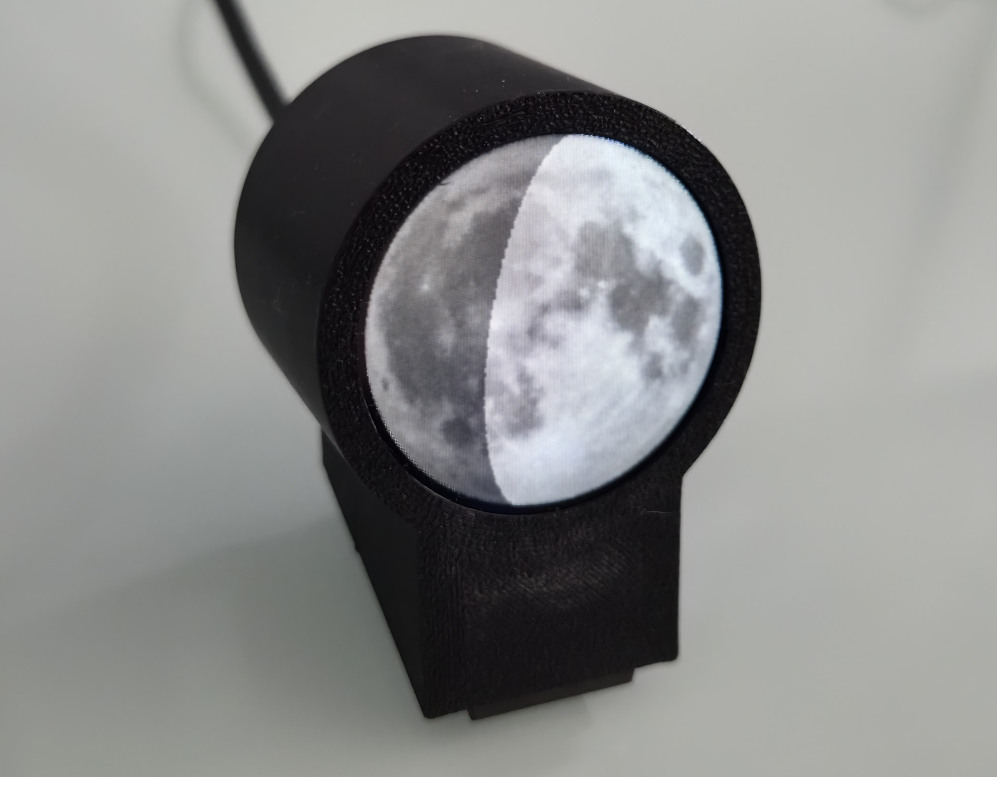
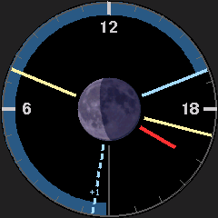

# Moon Display
The Moon Display is a compact desk device built around an ESP32-C3 and a round IPS display that shows the current view of the Moon in real time: not just the phase, but the actual appearance as seen from the observer's location at this very moment. Various display options are available, including texture choice, dimming of the unilluminated side, and whether libration is taken into account.
An internet connection is only needed as a time source — all astronomical calculations are performed on the device itself.



## Features
* Real-time moon rendering showing the current appearance as seen from the observer's location
* Accurate moon phase, libration, and axial tilt calculation
* Parallax correction based on the observer's geographic position
* All astronomical calculations performed locally on the device using formulas from *"Astronomical Algorithms"* by Jean Meeus
* Time synchronisation via NTP — internet connection only needed as a time source
* Connects to up to 3 configured Wi-Fi networks (automatic selection by signal strength)
* Texture options: high-resolution texture from NASA's CGI Moon Kit or self-taken photograph
* Optional dimming of the unilluminated lunar side
* Optional bluish tint when the moon is below the horizon
* Second display mode: 24-hour clock with sunrise/sunset, moonrise/moonset and the time the moon is above the horizon
* Telegram bot for changing settings, querying current sun/moon coordinates and an optional daily report
* Daily report can additionally (or exclusively) be sent as a push notification via the [Pushover](https://pushover.net) app
* The Telegram bot's profile photo shows the current moon and is updated daily
* Serial interface (115200 baud) for settings and debug output: Julian date, RA/Dec, azimuth/altitude, libration, phase, parallactic angle, sidereal time, rotation, mask, sunrise/sunset times

## Configuration

### Wi-Fi credentials
Copy `src/credentials.h.template` to `src/credentials.h` and add your networks:

```cpp
#define WIFI_SSID_1     "Network 1"
#define WIFI_PASSWORD_1 "Password 1"

#define WIFI_SSID_2     "Network 2"
#define WIFI_PASSWORD_2 "Password 2"

#define WIFI_SSID_3     ""   // leave empty, if not used
#define WIFI_PASSWORD_3 ""
```

### Telegram bot (optional)
1. Create a bot with [@BotFather](https://t.me/BotFather) and copy the token.
2. Find your own chat ID, e.g. with [@userinfobot](https://t.me/userinfobot).
3. Add both to `src/credentials.h`:
```cpp
#define TELEGRAM_BOT_TOKEN "123456:ABC..."
#define TELEGRAM_CHAT_ID   "12345678"
```
The bot only answers messages from this chat ID. Leave the token empty to disable the bot.

**Group (optional):** the bot can also serve a group. It posts the daily report there and sets the current moon as the group photo.
1. Add the bot to the group and make it an administrator with the right to change group info.
2. Find the group ID (starts with `-100…` for supergroups), e.g. by forwarding a group message to [@userinfobot](https://t.me/userinfobot) or from `getUpdates`.
3. Add it to `src/credentials.h`:
```cpp
#define TELEGRAM_GROUP_ID  "-1001234567890"
```
In the group the bot only reacts to commands sent by the user `TELEGRAM_CHAT_ID`; messages from other members, ordinary messages and commands addressed to other bots (`/cmd@OtherBot`) are ignored. Answers go to the chat where the command was sent. Telegram shows a service message in the group each time the photo changes, i.e. once a day.

| Command | Description |
|---|---|
| `/mond` | Current moon coordinates: RA/Dec, azimuth/altitude, distance, phase, libration |
| `/bild` | Current moon image as shown on the display (PNG) |
| `/profilbild` | Update the bot's profile photo (and the group photo) now |
| `/sonne` | Current sun coordinates: RA/Dec, azimuth/altitude |
| `/bericht` | Send the daily report now (also to Pushover, if configured) |
| `/config` | Show current configuration |
| `/standort <lat> <lon>` | Set observer location in decimal degrees |
| `/optionen <value>` | Set display options bitmask (see below) |
| `/auto on\|off` | Enable or disable the daily report (auto mode) |
| `/autozeit HH:MM` | Time of the daily report (local time) |
| `/zeitzone <POSIX-TZ>` | Time zone used for all displayed times |
| `/modus mond\|uhr` | Display mode: live moon or 24-hour clock |

**Auto mode:** once a day at the configured time the bot sends a compact report to the private chat, the group (if configured) and Pushover (if configured), for example:
```
📅 27.09.2026

☼↑ 07:14 ☼↓ 19:05 (−2'3'')
☽↓ 08:12 ☽↑ 19:40
🌔 73% (⬈) ▅⇡
🌕🔴 28.08.
```
* `☼↑`/`☼↓`: sunrise and sunset, followed by the change of sunset time compared to the previous day (minutes'seconds'')
* `☽↑`/`☽↓`: moonrise and moonset in chronological order; events that do not occur on this day are omitted
* Moon phase symbol, illuminated fraction and `⬈` waxing / `⬊` waning
* `▁▂▃▅▇`: today's culmination height of the moon relative to the range possible at the observer's latitude (declination ±28.6° at major lunar standstill). The outer levels are narrow, so `▁`/`▇` only appear on the few days around the monthly extremes.
* `⇡`/`⇣`: tomorrow's culmination is higher/lower than today's
* Events within the next 14 days (line only present if there are any), each with its local date:
  * `🌕🔴` lunar eclipse (umbral, |β| < 0.95° at full moon), `✗` appended if the moon is below the horizon at mid-eclipse
  * `☀🌑` solar eclipse somewhere on Earth (|β| < 1.45° at new moon; local visibility is not checked)
  * `🌕＋`/`🌕－` super moon (full moon closer than 360 000 km) / mini moon (farther than 405 000 km)

Sunrise/sunset are calculated with Meeus' method, moonrise/moonset by hourly sampling of the moon's altitude with quadratic (Lagrange) interpolation of the horizon crossing, using the horizon altitude after Meeus. Full and new moon are found by bisection of the moon's elongation. All calculations are done in UT; the report covers the local calendar day (events of the UT days overlapping it are converted to local time and filtered by local date).

**Profile and group photo:** after start and then daily at the report time (independent of auto mode), the bot renders the current moon with the fixed display options 13 (darkened unilluminated side, NASA texture, libration), encodes it as a 240×240 JPEG on the device and sets it as its profile photo via `setMyProfilePhoto` and, if a group is configured, as the group photo via `setChatPhoto`. If an update fails, only the failed one is retried every 15 minutes. The JPEG is created in a temporary 48 KB RAM buffer; nothing is stored in flash.

### Pushover (optional)
The daily report can also be delivered as a push notification via [Pushover](https://pushover.net). This works with or without the Telegram bot; if both are configured, the report goes to both.
1. Create an application at [pushover.net/apps/build](https://pushover.net/apps/build) and copy its API token.
2. Copy your user key from the Pushover dashboard.
3. Add both to `src/credentials.h`:
```cpp
#define PUSHOVER_APP_TOKEN "azGD..."
#define PUSHOVER_USER_KEY  "uQiR..."
#define PUSHOVER_DEVICE    ""   // optional: device name, empty = all devices
```
Pushover only receives; auto mode and report time are set via Telegram or the serial interface (`set_auto`, `set_autotime`). If sending fails, it is retried every 5 minutes.

### NTP server
The NTP server and UTC offset are configured in `src/MondPhase.ino`:
```cpp
constexpr char NTP_SERVER[] = "pool.ntp.org";
```

### Runtime configuration via serial interface
All runtime settings are stored in flash (NVS) and survive reboots. Connect at **115200 baud** and use the following commands:

| Command | Description |
|---|---|
| `help` | Show available commands |
| `config` | Show current configuration |
| `set_location <lat> <lon>` | Set observer location in decimal degrees (e.g. `set_location 51.0 9.0`) |
| `set_options <value>` | Set display options as a bitmask (see below) |
| `moon [HH:MM:SS \| DD.MM.YYYY HH:MM:SS]` | Show moon for given time or current time |
| `moon_run` | Start live display (updates every minute) |
| `set_time DD.MM.YYYY HH:MM:SS` | Set system time manually (UTC) |
| `wifi [on\|off]` | Enable or disable Wi-Fi |
| `mode moon\|clock` | Display mode: live moon or 24-hour clock (persistent) |
| `set_auto on\|off` | Enable or disable the daily report (Telegram/Pushover) |
| `set_autotime HH:MM` | Time of the daily report (local time) |
| `set_timezone <POSIX-TZ>` | Time zone for displayed times (default `CET-1CEST,M3.5.0,M10.5.0/3`) |

**Display options bitmask** (combine with `+`):

| Bit | Value | Description |
|---|---|---|
| 0 | 1 | Darken unilluminated side (earthshine) |
| 1 | 2 | Bluish tint when moon is below horizon |
| 2 | 4 | Use NASA LROC texture instead of photograph |
| 3 | 8 | Apply libration |
| 4 | 16 | Ignore the parallactic angle: celestial north up instead of the zenith |
| 5 | 32 | Ignore the position angle of the moon's axis: lunar north pole up |

Example: `set_options 9` enables earthshine + libration.

By default the moon is shown as seen in the sky, with the zenith up. With bit 4 it appears as in an equatorially mounted telescope (celestial north up); with bits 4 and 5 combined, the lunar north pole points straight up, as in a lunar map. The terminator is rotated along with the moon, so the lit features stay correct.

## Display modes

**Moon** (default): real-time rendering of the moon, updated every minute.

**24-hour clock**: midnight at the bottom, 6 am on the left, noon at the top, 6 pm on the right. All times refer to the current local calendar day.
* Light yellow hands: sunrise and sunset
* Light blue hands: moonrise and moonset; the light blue segment at the rim shows when the moon is above the horizon
* Dashed light blue hand with `+1`/`-1`: the next event of the current or upcoming moon passage that falls on the next or previous day (at most one)
* Red hand: current time
* Grey line at the bottom: day boundary (midnight)
* Centre: current moon, rendered like the moon display



## Hardware
* ESP32-C3 Super Mini
* 1.28 inch round IPS display (GC9A01)

## Software Requirements
* [VS Code](https://code.visualstudio.com/) with the [pioarduino IDE extension](https://github.com/pioarduino/platform-espressif32)
* The following libraries are fetched automatically by pioarduino:
  * `Adafruit GFX Library`
  * `Adafruit GC9A01A`
  * `SerialCommands`
  * `UniversalTelegramBot`
  * `ArduinoJson` (v6)
  * `JPEGENC` (JPEG encoder for the bot's profile photo)

## Building and Flashing
1. Clone or download this repository and open the folder in VS Code.
2. pioarduino will automatically install the required libraries on first build.
3. Copy `src/credentials.h.template` to `src/credentials.h` and fill in your Wi-Fi credentials (and optionally the Telegram bot token and chat ID and/or the Pushover app token and user key).
4. Connect the ESP32-C3 via USB.
5. Click **Upload** in the pioarduino toolbar (or run `platformio run --target upload`) to build and flash the firmware.
6. Use the pioarduino **Serial Monitor** at 115200 baud to view debug output.

